# CueFrame examples

Finished pieces made with [CueFrame](https://github.com/JeffeyChou/cueframe), a browser-native
video and talk framework where every frame is a pure function of time. Explainers, character
animation, music videos and motion design, each a CueFrame project you can open, scrub and
re-render. The framework is a submodule pinned to the commit the examples were last checked
against, so adding an example never changes CueFrame and upgrading it is one reviewed bump.

Each preview below is a few seconds of the finished film (silent; the films have narration or
music). Click one to open the project. The "uses" line names the CueFrame guides
(`cueframe/docs/guide/`) and recipes the piece leans on, and the helpers it shares with other
pieces ([`kits/`](kits)) or keeps in its own `lib/`.

## Explainers

<table>
<tr>
<td width="50%" valign="top"><a href="examples/manim-kepler">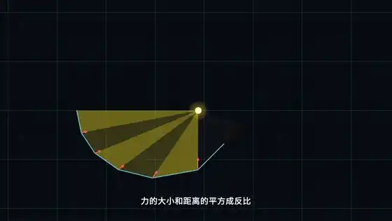</a><br>
<b><a href="examples/manim-kepler">manim-kepler</a></b>: Newton's geometric proof of Kepler's second law, 3Blue1Brown style, Chinese narration and subtitles, 3 min.<br>
<sub>uses: timing-and-audio, <code>lib/manim</code>, texmorph formula morphs</sub></td>
<td width="50%" valign="top"><a href="examples/r-chipdesign">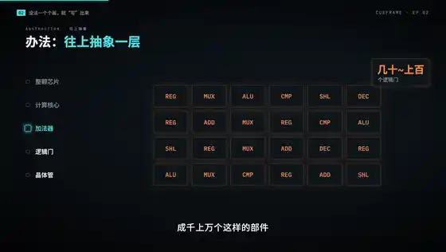</a><br>
<b><a href="examples/r-chipdesign">r-chipdesign</a></b>: how a chip is designed, from transistors to RTL; elements stay on screen and turn into the next idea instead of cutting.<br>
<sub>uses: continuity, long-form, plates, <code>lib/explainer</code>, <code>hud</code></sub></td>
</tr>
<tr>
<td width="50%" valign="top"><a href="examples/doodle-paged-attention">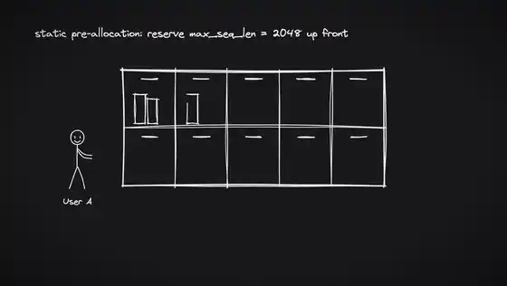</a><br>
<b><a href="examples/doodle-paged-attention">doodle-paged-attention</a></b>: PagedAttention on a hand-drawn slate board: five shots that stop on holds, then a zoom-out over the whole board.<br>
<sub>uses: presenting (holds), <code>lib/doodle</code></sub></td>
<td width="50%" valign="top"><a href="examples/r-gb300">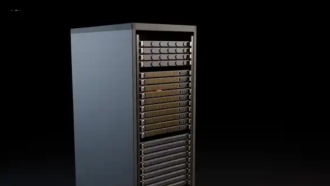</a><br>
<b><a href="examples/r-gb300">r-gb300</a></b>: a GB300 NVL72 rack rendered in Blender, with labels that track the parts as the camera moves, source badges and a log-axis chart.<br>
<sub>uses: plates (<code>cueframe-py blender</code>), <code>lib/annotate</code></sub></td>
</tr>
</table>

## Character animation

<table>
<tr>
<td width="50%" valign="top"><a href="examples/utc8-customs">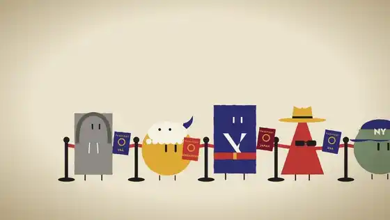</a><br>
<b><a href="examples/utc8-customs">utc8-customs</a></b>: a flat Bauhaus satire on printed paper. Claude is a border officer who catches UTC+8 travellers by their small tells. 3 min.<br>
<sub>uses: production (storyboard, review board), <code>kits/materials</code>, <code>acting</code>, <code>recipes/camera</code></sub></td>
<td width="50%" valign="top"><a href="examples/r-editing-village">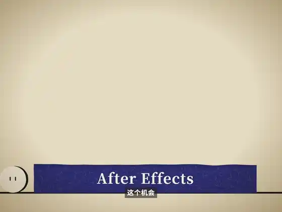</a><br>
<b><a href="examples/r-editing-village">r-editing-village</a></b>: a paper-textured fable about AI and video editing: an animation inside the animation, a camera that pulls out through a screen, a tower of software.<br>
<sub>uses: compositions, <code>kits/paper</code>, <code>acting</code>, <code>recipes/camera</code>, blur windows</sub></td>
</tr>
<tr>
<td width="50%" valign="top"><a href="examples/r-pcb-routing">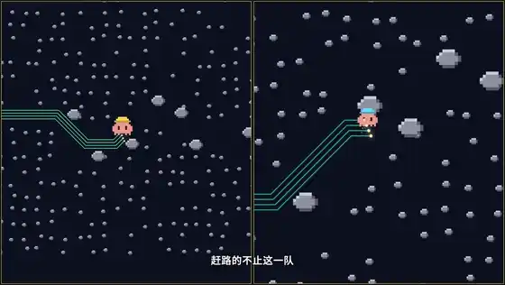</a><br>
<b><a href="examples/r-pcb-routing">r-pcb-routing</a></b>: a pixel rider routes a ten-layer board. The frame splits on the beat into ten worlds, which become an exploded 3D stack.<br>
<sub>uses: timing-and-audio (music-first narration), <code>lib/paths</code>, <code>space</code></sub></td>
<td width="50%" valign="top"><a href="examples/persimmon">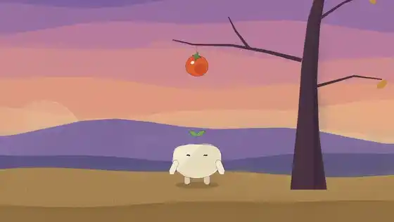</a><br>
<b><a href="examples/persimmon">persimmon</a></b>: a hand-painted cartoon. Dou, a bean with a sprout, jumps for the last persimmon, misses, and the wind drops it on its head. Watercolour, boiling ink, timed reads. 14 s.<br>
<sub>uses: brushFrame (settled backgrounds, keyed boil), production (storyboard reads), <code>kits/acting</code>, <code>lib/dou</code></sub></td>
</tr>
</table>

## Music videos and rhythm cuts

<table>
<tr>
<td width="50%" valign="top"><a href="examples/locomotion">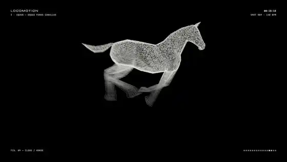</a><br>
<b><a href="examples/locomotion">locomotion</a></b>: car design borrows from animals. Muybridge's gallop becomes a point-cloud Ferrari; red traces drawn on each animal land on the car across the cut.<br>
<sub>uses: rhythm (<code>kits/beatcut</code>, footage frames), three.js, ASCII / print looks</sub></td>
<td width="50%" valign="top"><a href="examples/survey-of-rain">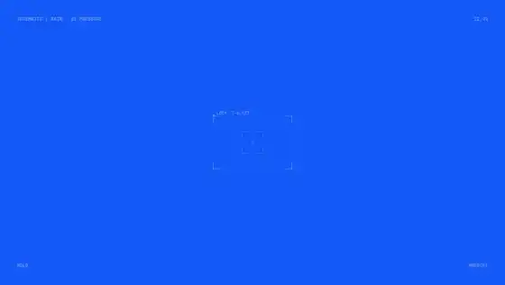</a><br>
<b><a href="examples/survey-of-rain">survey-of-rain</a></b>: rain, storm and bird footage cut to a song under a live schematic overlay of tracked points, chains and telemetry.<br>
<sub>uses: rhythm, <code>lib/schematic</code>, <code>kits/beatcut</code></sub></td>
</tr>
<tr>
<td width="50%" valign="top"><a href="examples/r-ascii">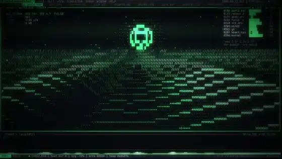</a><br>
<b><a href="examples/r-ascii">r-ascii</a></b>: a full-length ASCII music video for <i>world.execute(me);</i> inside one terminal UI, with lyric-timed captions and a spectrum. 3.5 min.<br>
<sub>uses: timing-and-audio, its own cell engine and CRT post (<code>engine/</code>, <code>crt.ts</code>)</sub></td>
<td width="50%" valign="top"><a href="examples/r-pdoom">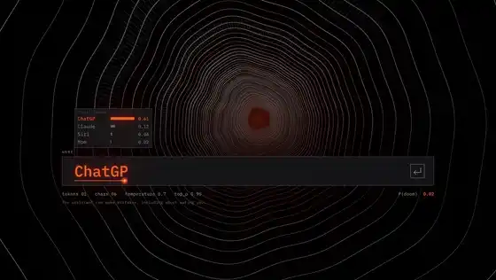</a><br>
<b><a href="examples/r-pdoom">r-pdoom</a></b>: the prompt-and-hook opening of <i>I'm Upping My P(doom)</i>: a typed prompt, then kinetic type on the beat.<br>
<sub>uses: authoring, kinetic type on beats</sub></td>
</tr>
</table>

## Motion design and promos

<table>
<tr>
<td width="50%" valign="top"><a href="examples/r-algebra">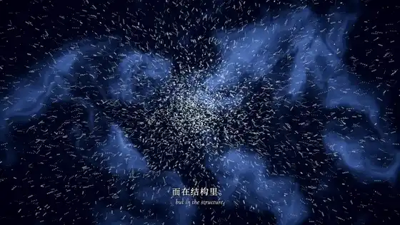</a><br>
<b><a href="examples/r-algebra">r-algebra</a></b>: a title sequence for abstract algebra: nebula particles gather into a snowflake, flare, and resolve into the Chinese title for abstract algebra.<br>
<sub>uses: graphics (HDR, particles, bloom)</sub></td>
<td width="50%" valign="top"><a href="examples/r-watchdogs">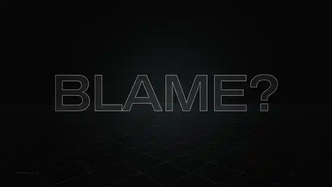</a><br>
<b><a href="examples/r-watchdogs">r-watchdogs</a></b>: hacker-thriller motion graphics: 3D type, a wireframe city, a dossier and dot-matrix headlines.<br>
<sub>uses: graphics, <code>recipes/motion</code></sub></td>
</tr>
<tr>
<td width="50%" valign="top"><a href="examples/r-promo"></a><br>
<b><a href="examples/r-promo">r-promo</a></b>: a 46 s portrait product promo with TTS narration, comic bursts, synced sound effects and captions.<br>
<sub>uses: timing-and-audio, <code>lib/karaoke</code>, <code>score.py</code></sub></td>
<td width="50%" valign="top"></td>
</tr>
</table>

The `r-` pieces are replicas: slices rebuilt from a reference video or repository, to see how close
CueFrame gets to the original and at what cost (CueFrame `docs/benchmark/` and each piece's README).

## Setup

```
git clone --recurse-submodules https://github.com/JeffeyChou/cueframe-examples.git
cd cueframe-examples
pnpm bootstrap    # submodules, CueFrame + texmorph + example deps, Python tools, large fonts
```

Then, from the repository root:

```
pnpm exec cueframe dev examples/manim-kepler
pnpm exec cueframe stills examples/r-ascii --times 3,9
pnpm exec cueframe export examples/doodle-paged-attention
pnpm check                      # check types and a still for every example
```

Each example's README has its own commands; `make.sh` scripts run from the repository root.
Some examples import files their `make.sh` generates (`build/…`) and declare them in their
`package.json` (`cueframe.generated`, with what building them `needs`). `pnpm check` reports such a
project as SKIP until those files exist; `pnpm check --strict` fails instead. A missing import that
is not declared always fails. `make.sh` scripts use `jq`. `pnpm bootstrap` builds r-algebra's font subsets.
The others need more than a clone:

| Example | Needs | Build |
|---|---|---|
| `r-promo` | network for TTS | `bash examples/r-promo/make.sh` |
| `r-ascii` | your own copy of the song | `examples/r-ascii/README.md` |
| `manim-kepler`, `r-chipdesign`, `r-editing-village`, `r-pcb-routing` | a local IndexTTS voice (`../index-tts`, `../voices`) | `bash examples/<name>/make.sh` |
| `utc8-customs` | local MOSS-TTS | `bash examples/utc8-customs/make.sh` |
| `r-chipdesign`, `r-gb300` | Blender 5.2 for the 3D plates | `bash examples/<name>/make.sh` |
| `locomotion`, `survey-of-rain` | network: footage and music are fetched, never committed | `bash examples/<name>/make.sh` |

`texmorph/` and `brushFrame/` are submodules too: CueFrame finds them beside itself.

To refresh a preview, cut 3–7 s of the finished film to a 560 px, 12 fps animated WebP of at most
~700 KB at `examples/<name>/preview.webp`:

```
ffmpeg -ss <start> -t <seconds> -i examples/<name>/out/landscape.mp4 -an \
  -vf fps=12,scale=560:-2:flags=lanczos -c:v libwebp_anim -q:v 40 -compression_level 4 -loop 0 \
  examples/<name>/preview.webp
```

## Licences

Code is MIT (`LICENSE`). Fonts carry their own OFL files next to them; large CJK fonts are not
committed and come from `scripts/fetch-fonts.sh`. The songs of the music-video replicas are not
included; r-ascii and r-pdoom carry lyric timing data (`data/lyrics.json`), whose words belong to
their authors (see each example's README). Footage, music and models fetched by `make.sh` keep
their own licences (each example's README lists them). The previews are short excerpts of the
finished films.
